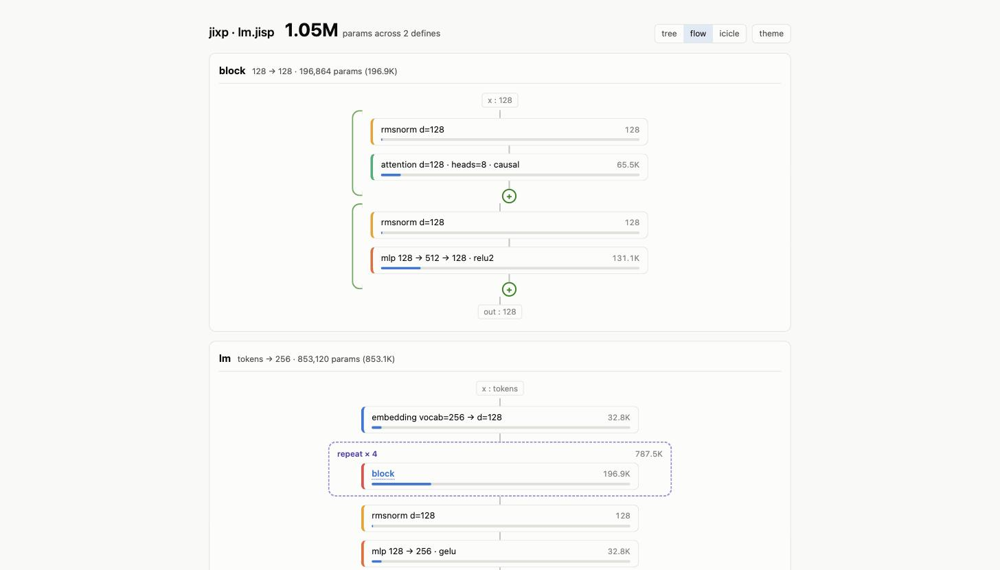

# jixp

A tiny Lisp that compiles neural network definitions to pure-[JAX](https://github.com/jax-ml/jax) Python.
(The language and file extension are `jixp` — j-expressions.)

jixp is three small pieces, each built on the last:

1. **A parser** (`jixp.py`) — s-expressions to plain Python lists/tuples.
2. **An evaluator** (`jixp.py`) — a minimal Lisp: `quote`, `if`, `define`, `lambda`, arithmetic.
3. **A compiler** (`compiler.py`) — a JAX DSL: describe a model as s-expressions, get a
   dependency-free Python module of `init_*(key)` / `apply(params, x)` functions.
   The compiler evaluates dimension expressions with the interpreter from step 2.

```lisp
; examples/gpt/gpt.jixp — a GPT-2-style decoder: learned positional
; embeddings, pre-LN blocks, biased gelu MLPs; byte-level (the 256 byte
; values are the vocab), token ids (batch, seq) -> logits
(let-dim
  (vocab 256)
  (d 128)
  (heads 8)
  (layers 4)
  (block-size 512))

(define block (chain
  (residual (layernorm d)
            (attention d heads #:causal))
  (residual (layernorm d)
            (mlp d [4d] d #:bias))))

(define gpt (chain
  (embedding vocab d)
  (pos-embedding block-size d)
  (repeat layers block)
  (layernorm d)
  (mlp d [] vocab)))
```

```console
$ python compiler.py examples/gpt/gpt.jixp
wrote examples/gpt/gpt.py
```

The output is readable, framework-free JAX — every `define` becomes a pair of
functions, dims baked in as literals (abridged):

```python
__all__ = [
    "init_block", "block",
    "init_gpt", "gpt",
]

DIMS = {"vocab": 256, "d": 128, "heads": 8, "layers": 4, "block_size": 512}


def _gpt_layer2(params, x):
    for layer_params in params:
        x = block(layer_params, x)
    return x


@jax.jit
def gpt(params, x):
    x = _gpt_layer0(params[0], x)
    x = _gpt_layer1(params[1], x)
    x = _gpt_layer2(params[2], x)
    x = _gpt_layer3(params[3], x)
    x = _gpt_layer4(params[4], x)
    return x
```

```python
import jax, gpt

params = gpt.init_gpt(jax.random.PRNGKey(0))
logits = gpt.gpt(params, tokens)  # tokens: int (batch, seq) -> (batch, seq, 256)
```

## Workflow

Write the `.jixp`, compile it, and import the generated module into ordinary
JAX code — jixp is a build step, never a runtime dependency. A complete
train-XOR example lives in `examples/`:

```lisp
; examples/xor/xor.jixp
(define net (mlp 2 [8 8] 1 #:activation tanh))
```

```python
# examples/xor/train.py (abridged)
import xor                                    # the generated module

params = xor.init_net(jax.random.PRNGKey(0))

def loss_fn(params):
    return jnp.mean((xor.net(params, X) - Y) ** 2)

@jax.jit
def step(params):
    loss, grads = jax.value_and_grad(loss_fn)(params)
    return jax.tree.map(lambda p, g: p - 0.1 * g, params, grads), loss
```

```console
$ python compiler.py examples/xor/xor.jixp
$ uv run --with jax python examples/xor/train.py
step    0  loss 1.472630
step 2000  loss 0.000000
predictions: [0.0, 1.0, 1.0, 0.0]
```

### Visualize

```console
$ python compiler.py examples/lm/lm.jixp --viz --json
wrote examples/lm/lm.py
wrote examples/lm/lm.model.json
wrote examples/lm/lm.html
```



`--viz` writes a self-contained interactive HTML explorer (no dependencies, no
server): a collapsible tree with one node per *source* block — `repeat` is a
single node with multiplied params — so it stays small for arbitrarily large
models. Each node shows its dims, exact parameter count (computed statically),
and share-of-model meter; light/dark themes included. Three views: a
collapsible **tree**, a **flow** diagram (residuals drawn as skip
connections into a ⊕ merge, `repeat` as a dashed ×N container), and an
**icicle** param map where width is parameter share. `--json` writes the same
structural summary as plain JSON for your own tooling, and it's also embedded
in the HTML. The counts are exact: a test asserts they equal what `init_*`
actually allocates under JAX.

There are also real-data versions of the same pattern: `examples/mnist/mnist.jixp`
(one line: `(define classifier (mlp 784 [256 128] 10 #:bias))`) with
`examples/mnist/train.py` — downloads MNIST, hand-rolled cross-entropy and
SGD-with-momentum, ~98% test accuracy in three epochs on CPU — and
`examples/gpt/train.py`, which trains the GPT from the top of this README on
tiny-shakespeare byte-by-byte (hand-rolled Adam, ~0.9M params) and samples
from it.

Params are ordinary pytrees and the generated functions are pure, so `grad`,
`vmap`, optax optimizers, and orbax checkpointing all apply directly. Every
public apply function ships wrapped in `@jax.jit` (internals are inlined at
trace time); use `jax.disable_jit()` when you want to step through eagerly.

### MLX target

`--target mlx` emits the same module in [MLX](https://github.com/ml-explore/mlx)
dialect, which runs on the GPU on Apple silicon:

```console
$ python compiler.py examples/gpt/gpt.jixp --target mlx
```

The output is structurally identical — `import mlx.core as mx`, `@mx.compile`
on the public applies, keys from `mx.random.key(seed)` — and numerically
matches the JAX module (`jax.nn.gelu`'s default tanh approximation maps to
`mlx.nn.gelu_approx`; a test asserts logit parity). Training code pairs it
with `mx.value_and_grad` and `mlx.utils.tree_map` instead of `jax.grad` and
`jax.tree.map`, plus an `mx.eval(params, loss)` per step — MLX is lazy, so
that's what forces the compute.

## The DSL

Top-level forms:

| form | meaning |
|---|---|
| `(let-dim (name dim) ...)` | bind dimension names at compile time; later bindings may use earlier ones. Flat pairs `(let-dim d 128 heads 8)` also work |
| `(define name block)` | compile a block to `init_<name>(key)` and `<name>(params, x)` |

Blocks:

| block | meaning |
|---|---|
| `(mlp in [hidden...] out #:activation gelu? #:bias?)` | dense layers; activation (`relu` `relu2` `gelu` `silu` `sigmoid` `tanh`, default `gelu`) after each hidden layer, never after the output layer; bias-free unless `#:bias` |
| `(layernorm dim)` | layer normalization with scale and shift |
| `(rmsnorm dim #:no-scale?)` | RMS normalization with learnable scale; `#:no-scale` makes it parameter-free |
| `(embedding vocab dim)` | lookup table: int token ids `(..., seq)` → `(..., seq, dim)`; only valid at the start of a model |
| `(pos-embedding max-seq dim)` | learned positional table added to the input: `x + params[:seq]`; `max-seq` bounds the sequence length the weights support |
| `(attention dim heads #:causal?)` | multi-head self-attention over `(..., seq, dim)`; `#:causal` masks future positions |
| `(chain block...)` | sequential composition |
| `(residual block...)` | `x + body(x)`; body must preserve dim |
| `(repeat count block...)` | `count` copies with independent params; body must preserve dim |

Multi-block `residual`/`repeat` bodies chain implicitly: `(residual a b)`
is `(residual (chain a b))`.

A block position also accepts the name of an earlier `define` — references compile
to calls of that block's functions, and each use initializes fresh params (a
`define` is a template, not weight sharing).

### Dims

Anywhere a dimension is expected you can write a compile-time expression,
evaluated by the jixp interpreter:

```lisp
(let-dim (d 128) (ffn (* 4 d)))
(mlp d [4d (/ d 2)] d)        ; 4d is sugar for (* 4 d)
```

Dims must resolve to positive integers at compile time, which buys static shape
checking: `chain` verifies adjacent blocks agree, `residual`/`repeat` require
dim-preserving bodies, and `attention` requires `heads` to divide `dim` — all
before any Python runs.

`let-dim` bindings are also exported into the generated module as a `DIMS`
dict (hyphens mangled to underscores), so training scripts next to the model
can read `gpt.DIMS["block_size"]` instead of re-hardcoding values — the
`.jixp` file stays the single source of truth.

### Syntax notes

- `(...)` is always a form; `[...]` is always data (a tuple), e.g. mlp hidden dims.
- Required args are positional; options are keywords — valued (`#:activation relu`)
  or flags (`#:causal`).
- `;` starts a line comment.
- Names may use Racket-style hyphens (`attn-block`); they become underscores
  (`attn_block`) in the generated Python.

## The Lisp

The interpreter that powers dim expressions also stands alone:

```console
$ python jixp.py program.jixp
```

```lisp
(define fact (lambda (n) (if (< n 2) 1 (* n (fact (- n 1))))))
(fact 5)                       ; prints 120
```

Atoms are ints, floats, and symbols; special forms are `quote`, `if`, `define`,
and `lambda`; builtins are `+ - * / < > <= >= =`. Parse errors and eval errors
exit 1 with a message on stderr.

## Development

No runtime dependencies. Tests need pytest; the generated-code integration
tests additionally use JAX and skip cleanly without it:

```console
$ uv run --with pytest -- pytest            # unit tests
$ uv run --with pytest --with jax -- pytest # + integration: runs generated modules,
                                            #   checks shapes and causality
```

The HTML explorer is a Vite + React + TypeScript + Tailwind app in `viewer/`;
its single-file build (`viewer/dist/index.html`, committed) is the template
`--viz` fills in, so Python users never need node. After changing the viewer:

```console
$ npm --prefix viewer install
$ npm --prefix viewer run build   # typechecks, then bundles to one file
$ npm --prefix viewer run dev     # live dev server with a bundled sample model
```
